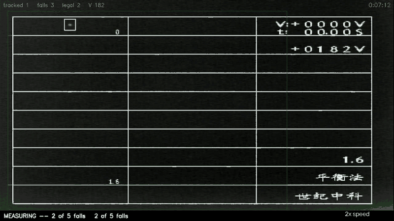

# millikan-edge

A learned droplet classifier for a real-time Millikan oil-drop assistant, quantized
to INT8 and run on the RK3588's NPU — measured before and after, on hand-labelled
ground truth and on the board itself.

## The problem

The parent project, a real-time assistant for the Millikan oil-drop experiment
(national undergraduate physics experiment competition, 2026), finds droplets with
classical computer vision: background subtraction, an adaptive threshold, then
area and circularity gates. On the analog microscope video those gates let noise
through. On 150 hand-labelled frames (1,213 droplets, labelled blind to the
pipeline, with a blind second look and an empty-spot control) the detector keeps
**1.35 false detections a frame at 81% precision**. Two hand-written gates were
tried and both failed the project's acceptance test.

## What this fork does

```
frame ─► background subtraction ─► threshold ─► area / circularity gates
                                                        │
                                   15k-parameter CNN on a 24×24 crop, INT8 on the NPU
                                                        │
                                                 tracker ─► fall timing
```

- **Training data without new labelling:** every raw recording is replayed through
  the unmodified pipeline and every blob is cut out with its background. The
  tracker's "confirmed" became the label only after a blind human review of 236
  tracks showed where it is trustworthy (long tracks) and where it is not (short
  tracks in noisy sessions, which became the hardest negatives). Droplet-free
  recordings supply certain negatives.
- **Split by recording day** — train 10-09 / 09-05 / 09-09, validate 09-07 /
  09-08 evening, test on the hand-labelled 09-08 morning session, scored once.
- **Classifier after the existing gates**, threshold 0.5 fixed on validation;
  installed from outside the pipeline's code, which stays untouched.

## Results

Detector stage on the hand-labelled test session (`results/fp32`, `results/int8`):

| | precision | recall | F1 | false detections / frame |
| :-- | --: | --: | --: | --: |
| classical | 81.0% | 95.8% | 87.8% | 1.35 |
| + classifier, FP32 | 92.6% | 93.3% | 93.0% | **0.45** |
| + classifier, INT8 | 92.1% | 93.7% | 92.9% | 0.48 |

- False detections fall by two-thirds for 2.5 points of recall; every one of the
  session's 19 legal falls is still measured, within 0.04 s.
- INT8 and FP32 make the same decision on 99.90% of 41,038 validation crops on the
  real NPU.
- What the operator is pointed at does not change: the hunt aid's rings and
  auto-pick suggest non-droplets as often with the classifier as without (9.2 vs 8.7
  per 10 minutes on the test session, the same on both unseen units; 477 suggested
  tracks judged blind, `results/suggestions`). Its own tests already kept that clean;
  the gain is in the detections underneath.

On two apparatus units never used in training, drawn at random, 100 hand-labelled
frames each with the same blind second look (`results/unseen`):

| | precision | recall | F1 | false detections / frame |
| :-- | --: | --: | --: | --: |
| classical | 69.8% | 87.6% | 77.7% | 11.7 |
| + classifier, INT8 | 93.5% | 87.4% | 90.3% | **1.9** |

- On the noisy unit false detections fall from 21.7 to 2.2 a frame for 0.4 points of
  recall; on the clean one, where the classical detector is already 93.7% precise,
  the classifier changes almost nothing (F1 91.2% → 91.4%). FP32 scores the same.
- A model retrained with four more units scores the same here (F1 90.1%) and on the
  test session, so the board keeps the first.

The camera dongle's faster MJPG mode (30 frames a second instead of ~22) was scored the
same way: one of those units recorded raw and then MJPG, 100 frames of each labelled
blind (`results/mjpg`). Compression artefacts pass the classical gates — precision
84.6% → 37.5%, false detections 1.9 → 11.5 a frame — but with the INT8 classifier the
two modes score alike: F1 85.4% raw, 85.1% MJPG, 0.70 and 0.14 false detections a
frame, for 3 points of recall. The faster mode is usable only with the classifier.

On the board — RK3588S, Ubuntu 22.04, RKNN runtime 2.3.2 (`results/board`):

| | per frame | FPS | detector + classifier | peak memory |
| :-- | --: | --: | --: | --: |
| classical | 38.3 ms | 26.1 | 5.5 ms | 175 MB |
| + classifier, FP32 on the CPU | 44.4 ms | 22.5 | 10.9 ms | 206 MB |
| + classifier, INT8 on the NPU, batched | **41.1 ms** | **24.3** | **8.9 ms** | 200 MB |

A dense-spray recording, ~26 candidate blobs a frame; per-frame times include PNG
decoding, which a live camera does not pay. The detector with the classifier fits a
30 fps frame budget (p90 16.3 ms).

- **With its window** — the operator's view, hunt aid and HUD drawn every frame — the
  same recording costs 48.1 ms a frame (~10 ms of it PNG decoding), down from 62.1 ms.
  Profiling found a speed estimate recomputed ~50 times a frame and the
  track-to-blob matching filled pair by pair; both now run in numpy with the same
  arithmetic — falls and suggestions identical on 10,000 replayed frames, every
  matching cost matrix identical to the bit. Its densest stretch (~90 live tracks)
  went from 76.4 to 61.4 ms a frame.
- **No throttling:** 15 minutes of the live view took the chip from 50 °C to 63 °C,
  levelling off, with every CPU and NPU clock at its maximum throughout; the board
  starts throttling at 75 °C.
- **The same model on a laptop NPU** (Snapdragon X Elite, ONNX Runtime with
  Qualcomm's QNN provider, same calibration crops): INT8 agrees with FP32 on 99.93%
  of validation crops and costs 0.0037 ms a crop in batches of 32 — 12× the RK3588's
  NPU (`results/laptop_npu`).

## What the board taught

- **A tiny model is all call overhead on an NPU.** One crop per call (0.19 ms) was
  slower than the CPU (0.12 ms). Packing a frame's crops into one call costs
  0.045 ms a crop — the NPU only pays off batched.
- **RKNN's `rknn_batch_size` produced wrong answers** for this model — every real
  droplet rejected, zero falls measured — caught by an agreement check before any
  timing was used. Baking the batch into the ONNX export fixed it.
- **Input layout matters:** NCHW input is converted on every call; handing over
  NHWC cut the single-crop call by 38%.

## Live



On two apparatus units held back from every recording (1-1 and 3-3, 27 Oct 2026), the
board ran the session live — the camera dongle on the board, the classifier on the
NPU, 21.3–21.5 updates a second — and measured 11 legal falls. Timed independently
from a phone video of the screen, every fall agrees within 0.9 s: on average 0.53 s
on 19 s falls and 0.35 s on 34 s ones (`results/live`).

`edge/live_viewer.py` runs the whole live session on the board — the camera
dongle on the board, the classifier on the NPU — with its window on a laptop over
the USB-C cable: clicks pick droplets, `q` ends the session, `--record` saves the
video. `edge/live_board.py --local` puts the window on the board's own desktop
instead (monitor on HDMI, mouse on USB); `edge/board_local.sh` adds desktop
launchers, so no laptop is needed at any step.

## Reproduce

Requirements: a Linux (or WSL2) machine for training and conversion, and the
project's raw recordings — lossless frame folders, tens of GB, not in this repo.

```
pip install -r edge/requirements.txt    # the laptop side: Python 3.11, versions pinned
bash edge/setup_wsl.sh                  # venv: torch 2.2, RKNN-Toolkit2 2.3.2, onnx
python edge/autolabel.py <recording>    # replay -> crops + tracker labels
python edge/review_tracks.py prepare    # blind clips; `review` to answer them
python edge/dataset.py                  # labels by the review's rules, split by day
python edge/train.py                    # FP32, best epoch on validation  (in WSL)
python edge/convert.py                  # INT8 + simulator check            (in WSL)
python edge/convert_batched.py          # batched NPU models                 (in WSL)
python edge/replay.py after             # the classifier in the pipeline, test session
python edge/int8_test.py                # INT8 on the test session           (in WSL)
python edge/score.py                    # every row against the hand labels
python edge/label.py sample|label|review <recording>   # hand labels for a new unit
python edge/score_unseen.py             # the units never used in training
python edge/fast.py check <recording> <frames>   # the speed-up changes no answer
python edge/fast.py exact <recording>   # ...nor a bit of any matching cost matrix
python3 edge/soak.py --minutes 15       # on the board: heat, clocks, frame rate
python3 edge/board_bench.py ...         # on the board: model, accuracy, pipeline
```

`docs/HANDOVER.md` records every decision, measurement and dead end in order;
`results/README.md` indexes each published number with the script that made it.

## Status

Done: the classifier, INT8 on the NPU, before/after on accuracy, latency and memory;
the test on two apparatus units never used in training; a live session on units held
back for it; the camera's MJPG mode scored against hand labels. Next: the live path on
MJPG, and the board's power draw.

## Origin

A fork of the competition team's repository, history included. The computer-vision
pipeline (`cv/`) and everything in `edge/` are by the repo owner; the app and LLM
parts (`app_js/`, `llm/`) are a teammate's and are not used here.
